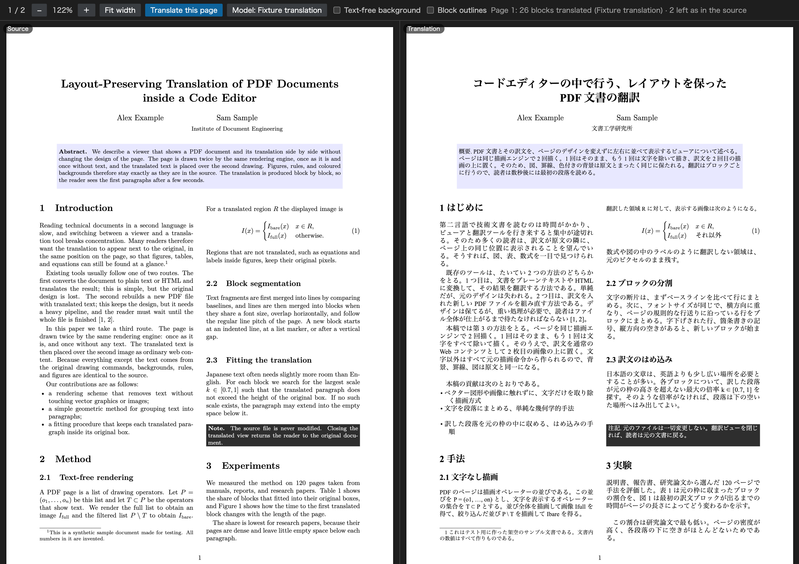

# PDF Translation Viewer

[English](README.md)

PDF とその訳文を、同じレイアウトのまま左右に並べて読むための VS Code 拡張です。左側には元のページをそのまま表示し、右側には同じページの文章だけを訳文に置き換えて表示します。図、表、数式、色付きの背景は元の位置から動きません。翻訳には **PLaMo API** や **GitHub Copilot** などの言語モデルを使えます。

これはプレビュー版です。まだできないことは[制約](#制約)にまとめています。

## 機能

- `.pdf` ファイルを、左右 2 つのペインを持つビューアで開きます。2 つのペインは一緒にスクロールし、一緒に拡大・縮小します。
- **このページを翻訳** をクリックすると、表示中のページを翻訳します。訳文は、届いたブロックから順に表示されます。
- 右側のページは PDF そのものから描きます。除くのは翻訳した文章だけなので、背景、罫線、画像、ベクターの図は作り直したものではなく、元のままです。
- 訳文は、元のブロックの枠に合わせて配置します。位置と幅は同じで、フォントの種類（明朝系・ゴシック系・等幅）、太さ、大きさ、色も原文に合わせます。原文より長くなる訳文は、少し小さく組むか、ブロックの下の空いた場所へ伸ばします。
- 別行立ての数式や、モデルが原文のまま返した行（人名、参考文献など）は、元の表示を残します。
- 訳文にマウスを重ねると、そのブロックの原文を表示します。
- 既定では日本語に翻訳します。設定で、ほかの言語も指定できます。
- 訳文はお使いのコンピューターにキャッシュします。一度翻訳したページは、リクエストなしで再表示されます。
- 画面は英語と日本語に対応しています。

## 使い方

VS Code 1.104 以降と、PLaMo の API キー、または GitHub Copilot など VS Code で使える言語モデルが必要です。

1. Visual Studio Marketplace から **PDF Translation Viewer** をインストールします。
2. PDF ファイルを開きます。ほかの PDF 拡張で開いた場合は、ファイルのタブを右クリックして **エディターを再度開く...**（Reopen Editor With...）を選び、**PDF Translation Viewer** を選びます。同じ一覧から、PDF ファイルの既定のエディターに設定することもできます。
3. ツールバーの **このページを翻訳** をクリックします。
4. 初回は、一覧からモデルを選びます。**PLaMo 3.1 Prime** を選び、API キーを求められたら入力します。GitHub Copilot などを選んだ場合は、VS Code の案内に従って利用を許可します。

訳文が右側に、ブロックごとに表示されます。別のページを翻訳するには、そのページまでスクロールして、もう一度 **このページを翻訳** をクリックします。

モデルを変えるには、ツールバーの **モデル: …** をクリックするか、コマンド パレットから **PDF Translation: モデルを選ぶ** を実行します。ほかの言語に翻訳するには、`pdfTranslation.targetLanguage` に `Simplified Chinese` や `Brazilian Portuguese` のように言語名を設定します。

### PLaMo の API キー

PLaMo の API キーは、PLaMo API コンソールのプロフィール画面で発行できます。ビューアーで入力したキーは VS Code のシークレットストレージに保存され、次回からも使えます。[公式のキー発行手順](https://docs.plamo.preferredai.jp/ja/getting-started)

コマンド パレットの **PDF Translation: PLaMo API キーを設定** でキーを変更できます。保存済みのキーを削除するには、入力欄を空にして確定します。保存済みのキーがない場合は、VS Code の起動時に渡した環境変数 `PLAMO_API_KEY` も使えます。

## コマンド

| コマンド | 説明 |
| --- | --- |
| **PDF Translation: 表示中のページを翻訳** | 表示中のページを翻訳します。ツールバーのボタンと同じです。 |
| **PDF Translation: モデルを選ぶ** | 翻訳に使う言語モデルを選びます。 |
| **PDF Translation: PLaMo API キーを設定** | PLaMo の API キーを登録、変更、削除します。 |
| **PDF Translation: 利用できる言語モデルを一覧表示** | PLaMo と VS Code が提供するモデルを、出力チャンネル **PDF Translation Viewer** に書き出します。 |
| **PDF Translation: 翻訳キャッシュを消去** | キャッシュした訳文を削除します。 |

## 設定

| 設定 | 既定値 | 説明 |
| --- | --- | --- |
| `pdfTranslation.targetLanguage` | `Japanese` | 翻訳先の言語。翻訳者に伝えるときのように言語名を書きます。 |

## 仕組み

PDF のページは、描画命令の並びです。このビューアは [PDF.js](https://mozilla.github.io/pdf.js/) で各ページを 2 回描きます。1 回はそのまま、もう 1 回は文字を表示する命令を除いて描きます。ページの文章は位置をもとに行とブロックにまとめ、ブロックをモデルに送り、返ってきた訳文を、そのブロックの文字なしの描画の上に重ねます。翻訳しないブロックは、そのままの描画を残します。

## 制約

- 段落、見出し、表のセルへの分割は、文字の位置だけをもとに行います。論文や報告書のように規則的なレイアウトの文書に向いていて、複雑なページではブロックがつながったり分かれたりすることがあります。
- 翻訳するのは、英語、フランス語、ドイツ語など、ラテン文字で書かれた文章です。日本語や中国語など、ほかの文字で書かれた PDF は、表示はできますが翻訳はしません。
- スキャンした PDF には、翻訳する文字がありません。
- 太字、リンク、上付き文字など、段落の中の書式は訳文に引き継ぎません。文中の数式は、プレーンテキストとしてモデルに送ります。
- 訳文は常にいちばん手前に描くので、原文と重なっていた図を覆うことがあります。
- 次の段や次のページへ続く段落は、2 つに分けて翻訳します。
- 検索、文字の選択、リンク、アウトライン、印刷にはまだ対応していません。翻訳したページを PDF として保存することもできません。

## プライバシー

ページを翻訳すると、そのページから抽出した文章が、選んだモデルへ送られます。PLaMo を選ぶと、拡張は文章を Preferred Networks の PLaMo API に直接送信します。VS Code のモデルを選ぶと、VS Code の Language Model API を通して送信します。選んだモデルの提供者の規約が適用されます。この拡張はテレメトリを収集しません。訳文は、お使いのコンピューターにある拡張の保存領域にキャッシュします。**PDF Translation: 翻訳キャッシュを消去** で削除できます。

## フィードバック

不具合や要望は [GitHub Issues](https://github.com/yhay81/pdf-translation-viewer/issues) へお寄せください。ブロックの分割や配置がおかしいページは、その PDF か、ツールバーの **ブロックの枠** をオンにしたスクリーンショットがあると調べやすくなります。

## ライセンス

[MIT](LICENSE)。この拡張は [PDF.js](https://github.com/mozilla/pdf.js)（Apache License 2.0）と、それに付属する文字マップ、標準フォント、画像デコーダーを同梱しています。それぞれのライセンスは、拡張の中の `ThirdPartyNotices.txt` にあります。
