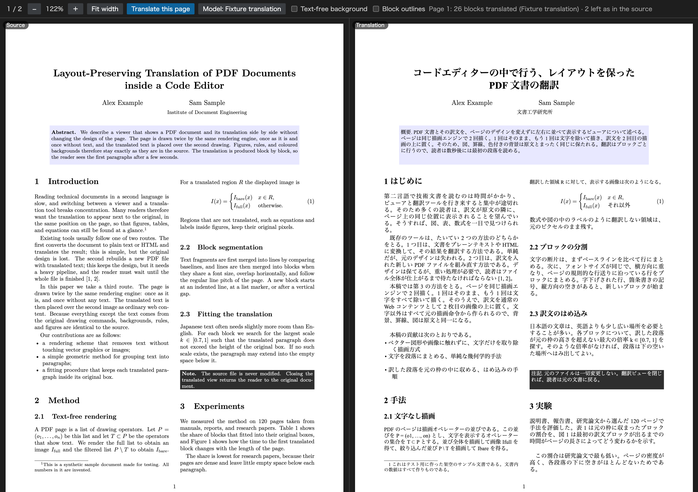

# PDF Translation Viewer

[日本語](README.ja.md)

Read a PDF with its translation beside it, in the same layout. The left pane shows the page as it is. The right pane shows the same page with its text replaced by the translation, so figures, tables, equations and colored backgrounds stay exactly where they are. Translation uses **GitHub Copilot** or another language model in VS Code, so there is no API key to set up.

This is a preview release. See [Limitations](#limitations) for what it does not do yet.

## Features

- Opens `.pdf` files in a viewer with two panes that scroll and zoom together.
- Translates the page on screen when you click **Translate this page**, and shows each block as soon as its translation arrives.
- Draws the right-hand page from the PDF itself, leaving out only the text that was translated. Backgrounds, rules, images and vector figures are the original ones, not a reconstruction.
- Fits each translation into the box of its source block: the same position and width, a font of the same kind (serif, sans-serif or monospace), and the same weight, size and color. A translation that is longer than its source is set slightly smaller, or runs into the empty space below the block.
- Leaves display equations, formulas, and lines the model returns unchanged (names, references) as they are in the original.
- Shows the source text of a translated block when you point at it.
- Translates into Japanese by default, and into any language you name in the settings.
- Caches translations on your computer. A page you translated before appears again without a request.
- The interface is in English and Japanese.

## Getting started

You need VS Code 1.104 or later, and GitHub Copilot or another extension that provides language models to VS Code.

1. Install **PDF Translation Viewer** from the Visual Studio Marketplace.
2. Open a PDF file. If another PDF extension opens it instead, right-click the file's tab, choose **Reopen Editor With...**, and pick **PDF Translation Viewer**.
3. Click **Translate this page** in the toolbar.
4. The first time, choose a model from the list, and allow the extension to use language models when VS Code asks.

The translation appears on the right, block by block. Scroll to another page and click **Translate this page** again to translate it.

To change the model, click **Model: …** in the toolbar, or run **PDF Translation: Choose Model** from the Command Palette. To translate into another language, set `pdfTranslation.targetLanguage`, for example to `Simplified Chinese` or `Brazilian Portuguese`.

## Commands

| Command | What it does |
| --- | --- |
| **PDF Translation: Translate Current Page** | Translates the page on screen. The same as the toolbar button. |
| **PDF Translation: Choose Model** | Chooses the language model to translate with. |
| **PDF Translation: List Available Language Models** | Writes the models that VS Code offers to this extension to the **PDF Translation Viewer** output channel. |
| **PDF Translation: Clear Translation Cache** | Deletes the cached translations. |

## Settings

| Setting | Default | Description |
| --- | --- | --- |
| `pdfTranslation.targetLanguage` | `Japanese` | The language to translate into, named as you would name it to a translator. |

## How it works

A PDF page is a list of drawing operators. The viewer renders each page twice with [PDF.js](https://mozilla.github.io/pdf.js/): once in full, and once without the operators that show text. It groups the text of the page into lines and blocks by position, sends the blocks to the model, and lays each translation over the text-free rendering of its block. Blocks that are not translated keep the pixels of the full rendering.

## Limitations

- The page is split into paragraphs, headings and table cells from the positions of the text alone. This works best on documents with a regular layout, such as papers and reports, and it can merge or split blocks on a complex page.
- It translates text written in the Latin alphabet, such as English, French or German. A PDF in Japanese, Chinese or another script is displayed but not translated.
- A scanned PDF has no text to translate.
- Formatting inside a paragraph, such as bold words, links and superscripts, is not kept in the translation. Formulas inside a sentence are sent to the model as plain text.
- A translation is always drawn on top, so it can cover a figure that overlapped the source text.
- A paragraph that continues in the next column or on the next page is translated in two parts.
- The viewer has no search, text selection, links, outline or printing yet, and it cannot save the translated page as a PDF.

## Privacy

When you translate a page, the text of that page is sent to the model you chose, through the Language Model API of VS Code and under the terms of that model's provider. The extension sends nothing else and collects no telemetry. Translations are cached in the extension's storage on your computer; **PDF Translation: Clear Translation Cache** deletes them.

## Feedback

Report problems and ideas in [GitHub Issues](https://github.com/yhay81/pdf-translation-viewer/issues). A page that is split or laid out badly is most useful with the PDF, or a screenshot with **Block outlines** switched on in the toolbar.

## License

[MIT](LICENSE). The extension bundles [PDF.js](https://github.com/mozilla/pdf.js) (Apache License 2.0) with its character maps, standard fonts and image decoders; their licenses are in `ThirdPartyNotices.txt` inside the extension.
